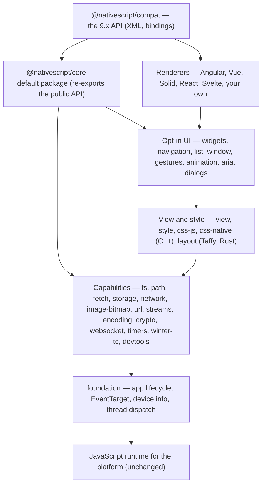
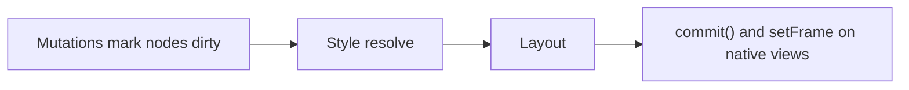

- Start Date: 2026-11-23
- Target Major Version: (not decided)
- Reference Issues: (none)
- Implementation PR: (leave this empty)

# Summary

> **Work in progress.** This RFC is not finalized. The design is still being iterated on and needs further input from the core team, plugin authors and the community before it can be considered for acceptance. Open questions are listed at the end.

This RFC proposes rebuilding `@nativescript/core` as a set of small packages that can be used, skipped or replaced independently. `@nativescript/core` remains the package apps install and re-exports them.

- A kernel with no UI, so a headless app (for example a macOS command-line tool) links no view code.
- Capabilities such as `fs` and `fetch` as separate packages, named after the web or Node API they provide.
- A new view system built on ordinary classes, a DOM-subset tree and one flush per frame.
- A CSS engine in C++ that memory-maps CSS compiled at build time, behind an interface that a JavaScript engine also implements.
- Layout by Taffy (flexbox, CSS grid and block) on every platform, with the existing layouts kept as TypeScript classes that translate to it, and view flattening for containers that only arrange children.
- Platform support expressed as one folder per platform (`ios/`, `android/`, `macos/`) that implements the package's `interface.ts`, so new platforms such as macOS, Windows and Linux add folders and change no shared code.
- `@nativescript/core` kept as the one package an app installs and the one place apps and plugins import from. It re-exports every public API from a single entry, with no deep imports.
- A compat package carrying the 9.x API, which existing apps and plugins resolve to at build time, so they run unchanged. XML views exist only there.

All package names are working names under the `@nativescript/` scope.

# Basic example

A minimal UI app with the default package:

```ts
import { app, createUI, Stack, Label } from '@nativescript/core';
import sheet from './app.css';

app.addEventListener('launch', () => {
  const ui = createUI();
  ui.style.addSheet(sheet);
  const root = new Stack();
  root.className = 'home';
  const label = new Label();
  label.text = 'Hello';
  root.appendChild(label);
  ui.mount(root);
});
```

# Motivation

The numbers below come from a survey of `@nativescript/core` 9.1.4.

**Everything is reachable from everything.**

- The package has no `exports` field, and `index.ts` imports `./globals` on its first line.
- `globals` imports `application`, which imports the XML `Builder`, which reaches the whole UI.
- `http-request` imports `ImageSource`, which reaches fonts, the property system, `ViewBase` and `Page`.
- `utils` on Android imports the frame stack.
- About 50 `*-common.ts` files exist partly to break import cycles.

The result is that importing one function loads most of the package, and a headless app cannot exist.

**The property system carries the cascade.** About 281 properties are registered. Each one creates four to seven symbols, and the main property file is 1,781 lines. CSS values, inheritance and defaults are resolved inside JavaScript property setters.

**A view is heavy before it shows anything.** `ViewBase`, `ViewCommon` and the platform `View` total about 5,300 lines and declare roughly 120 to 140 instance fields.

**CSS does most of its work on the device.**

- Sheets ship as a JSON syntax tree inside the JavaScript bundle.
- Selectors are parsed on the device at startup.
- There is no shared match cache.
- Specificity is computed as a 100/10/1 sum, which is incorrect.
- `!important` is stripped.

**Layout is implemented twice.** iOS layouts are about 3,000 lines of TypeScript. Android layouts are about 5,200 lines of Java. They must be kept in agreement by hand.

**XML ships to everyone.** Most apps today use Angular, Vue, Solid, Svelte or React, but the XML builder, bindings and module registry are in every bundle.

**APIs follow no standard.** `Observable`, `Http`, `File`, `Folder`, `ApplicationSettings` and `Connectivity` are NativeScript inventions with their own names and semantics.

## Goals

1. Packages that can be used alone, skipped, or replaced.
2. Tree-shakable by construction: no work at import, no catch-all barrel.
3. No third-party runtime dependencies below the compat layer.
4. A view system that does less work per view and per property set.
5. A CSS engine that parses nothing on the device, with a native and a JavaScript implementation that are interchangeable.
6. One layout implementation for all platforms.
7. New platforms without changes to shared code.
8. Standard APIs wherever a standard exists.
9. Existing apps and plugins keep working through a compat layer.

## Non-goals

- Implementing the browser DOM. View nodes implement a subset.
- Node.js compatibility beyond a stated subset of `fs` and `path`.
- Moving widgets or native view access into C++.
- Reactive state. A view stores the values it is given and applies them in the next flush; state, and the decision of when to write a property, belong to the UI framework or the app. `Observable`, `ObservableArray`, `bindingContext` and binding expressions are part of compat.
- Supporting legacy (compat) apps on platforms other than iOS and Android.

# Detailed design

## Design rules

1. **Imports point down.** A package may import only from layers below it. A CI check enforces this.
2. **No work at import.** Every package is `sideEffects: false`. Globals are installed by an explicit call.
3. **Lower layers expose slots.** A feature such as gestures attaches to a node through an extension slot. The node does not import the feature.
4. **The public surface is the package root.** Each package's `exports` map lists its root entry, and everything an app or a plugin may need is exported there. Deep imports do not resolve. `@nativescript/core` is the one package that re-exports others, and it contains re-exports and nothing else.
5. **Platform code lives in platform folders.** No shared file makes a toolkit call. Each package declares its platform interface in `interface.ts`, and one folder per platform implements it.
6. **Zero third-party runtime dependencies below compat.**
7. **Pay for what you import.**
8. **Strings are parsed once.** CSS text is a build-time input. Typed values cross the JavaScript and native boundary.
9. **Standards first.** Where a WHATWG, W3C, TC39 or WinterTC specification covers something, the public API is that specification.
10. **Native where it is invisible.** Pure computation (selector matching, cascade, layout) may move to native code: C++ for the CSS engine, Rust for layout. Anything a developer writes, reads or debugs stays in TypeScript.

## Package map



A headless app links only `foundation` and the capabilities it imports. Platform folders live inside each package, and a build includes the folder for one target.

| Package | Owns |
|---|---|
| `foundation` | Process and app lifecycle events, `EventTarget`, device info, main-thread dispatch, `Color` as a packed value. Target: under 3,000 lines. |
| `fs`, `path`, `fetch`, `storage`, `network`, `image-bitmap` | One capability each: a shared public API over a small backend interface. |
| `url`, `streams`, `encoding`, `crypto`, `websocket`, `timers` | One web API each. |
| `winter-tc` | `installMinimumCommon()`, which puts the WinterTC Minimum Common API on `globalThis`. |
| `view` | `ViewElement`, the `@prop` decorator, the node tree, the frame flush, the `ViewPlatform` interface. |
| `style` | The `StyleEngine` interface, the style property registry, the change buffer format. |
| `css-native` | C++ engine: sheet loader, matcher, cascade, computed-style cache, invalidation, transitions. |
| `css-js` | The same interface in TypeScript over the same compiled sheets. |
| `css-compiler` | Build-time CSS text to binary sheet. Loadable on device for runtime CSS strings. |
| `layout` | Taffy (Rust) for flexbox, CSS grid and block, its bindings, view flattening, and the TypeScript classes that translate the existing layouts into Taffy styles. |
| `widgets` | Label, Button, Image and the rest, all exported from the package root. |
| `window`, `navigation`, `gestures`, `animation`, `aria`, `dialogs`, `list` | One feature each. |
| `core` | The default package. What an app installs and what apps and plugins import from. Re-exports only. |
| `compat` | The 9.x API, for existing apps and plugins. |

### The default package: `@nativescript/core`

`@nativescript/core` keeps its name and its role: the one package an app installs, and the one place apps and plugins import from. From its next major version it depends on the packages in this RFC at pinned versions and re-exports their public API from a single entry. It contains no code of its own.

```ts
import { app, readFile, fetch, createUI, Stack, Label, Button } from '@nativescript/core';
```

| Group | Exported from `@nativescript/core` |
|---|---|
| App and device | `foundation`: `app`, lifecycle events, device information, main-thread dispatch, `Color`, and the native helpers plugins rely on (current activity and application context on Android, key window and root view controller on iOS) |
| Capabilities | `fs`, `path`, `fetch`, `storage`, `network`, `image-bitmap`, `url`, `streams`, `encoding`, `crypto`, `websocket`, `timers`, and `installMinimumCommon` from `winter-tc` |
| UI | `createUI`, every widget and layout in `widgets`, `window`, `navigation`, `list`, `gestures`, `animation`, `aria`, `dialogs`, with the native CSS engine as the default for `createUI` |
| For plugin authors | `ViewElement`, `prop`, `Changed`, `MeasureSpec`, `Size`, `StyleChanges`, style property registration, the base class for custom layouts, the widget base classes, and the platform interfaces |
| Left out | `css-js`, `css-compiler`, `devtools` and `compat` |

- **One entry and no deep imports.** The `exports` map lists the root. Anything an app or a plugin needs is exported there. When a plugin needs something that is missing, the fix is to export it.
- **Unused exports cost nothing.** Every package behind the entry does no work at import and is marked `sideEffects: false`, so the bundler keeps only what the app uses. A headless app that imports `app` and `readFile` ships no UI.
- **Partial platforms still build.** On a platform that has no implementation for some widget, the build fails only if the app uses that widget. This needs confirming in a prototype.
- **`createUI()` needs no arguments.** The native CSS engine is the default. Passing `{ style: jsCss() }` replaces it.
- **One version number.** A release of `@nativescript/core` pins a set of package versions that were tested together.
- **The individual packages stay public.** An app that wants a smaller install, or its own replacement for one part, depends on them directly, each through its own root entry.
- **Globals stay opt-in.** Importing `@nativescript/core` installs nothing on `globalThis`.

### Replacing a package

Every package, `@nativescript/core` included, reaches a capability by importing its package name: `import { readFile } from '@nativescript/fs'`. That name is the single place a replacement goes in. The app maps it to another package with its package manager:

```jsonc
// package.json of the app
"overrides": {
  "@nativescript/fs": "npm:@acme/fs@^1.0.0"
}
```

This is npm's `overrides` field; pnpm has the same field and Yarn calls it `resolutions`. The package manager installs `@acme/fs` wherever any package asks for `@nativescript/fs`, so the app holds one copy and every importer gets it:

- **Core and every other package use it.** `fetch`, `storage`, the widgets and plugins all import `@nativescript/fs` by name, and that name now resolves to the replacement.
- **`@nativescript/core` re-exports it.** `readFile` imported from `@nativescript/core` is the replacement's `readFile`.
- **Types follow.** TypeScript reads the replacement's declarations, so a missing or mistyped export is a type error in the importer.

A replacement has two obligations: export the same root API as the package it replaces, and pass that package's conformance tests. Each package publishes its conformance tests so that a replacement can run them.

A replacement that changes only part of a package depends on the original under a second name and re-exports what it keeps. How `overrides` treats that second name needs confirming in a prototype.

#### How UI code reaches `fs`

UI packages load files through the capability packages, by URL. `background-image` is the example:

```
background-image: url('~/assets/hero.png')
  → the platform's style code calls fetch(url)           // @nativescript/fetch
  → fetch reads a file or app URL with readFile         // @nativescript/fs
  → createImageBitmap(blob) decodes off the main thread  // @nativescript/image-bitmap
  → the bitmap is applied to the native view
```

`Image.src` and fonts loaded by URL take the same path. An app that replaces `fs` therefore serves those files too, and an app that replaces `fetch` controls every URL load, local and remote.

| Read through `fs` and `fetch` | Read by native code directly |
| --- | --- |
| Images named by path or URL in CSS and in widget properties, fonts loaded by URL, any file an app or plugin reads | The compiled stylesheet, which the C++ engine maps into memory; platform resources such as `res://` images, asset catalogs and drawables; the JavaScript bundle, which the runtime loads |

## Web standards and naming

| Area | Standard used | Replaces |
|---|---|---|
| Events | `EventTarget`, `Event`, `CustomEvent`, `AbortSignal` | `Observable`, `EventData` |
| Input | Pointer Events, UI Events (`click`, `pointerdown`, `keydown`) | `tap`, touch-only gestures |
| Animation | Web Animations | `view.animate({...})` |
| Accessibility | WAI-ARIA `role` and `aria-*` | `accessibilityLabel` and related |
| Networking | `fetch`, Streams, `WebSocket` | `Http`, `http-request` |
| Storage | Web Storage (`localStorage`) | `ApplicationSettings` |
| Files | Node `fs/promises` subset, with WHATWG file-system handles beside it | `File`, `Folder`, `knownFolders` |
| Globals | WinterTC Minimum Common API | `globals` |
| Styling | CSS specifications for selectors, cascade, variables, values | NativeScript CSS behaviour |

Names are chosen in this order:

1. The web name, when a web standard covers it.
2. The cross-runtime name when the web has none. In practice this is Node's (`fs`, `path`), implemented as a stated subset.
3. The native platforms' name when the thing is native by nature (`View`).
4. A plain descriptive word. Nothing is coined.

Conformance is tested, not claimed: the relevant Web Platform Tests directories run against the `headless` target in CI.

## Foundation

`foundation` is the only package every app needs.

- `app` is an `EventTarget` that emits `launch`, `suspend`, `resume`, `exit`, `lowMemory` and uncaught-error events.
- It defines an `AppPlatform` interface: lifecycle source, main-thread dispatch, device information.
- It has no view, style or window code.

```ts
import { app } from '@nativescript/foundation';
import { readFile } from '@nativescript/fs';

app.run(async (args) => {
  const text = await readFile(args[0], 'utf8');
  console.log(text.length);
  app.exit(0);
});
```

## View system

A widget is an ordinary class. A shared base class declares what the widget is. A class in the platform folder says how it is realised.

```ts
// @nativescript/widgets/label/base.ts — shared, no platform code
import { ViewElement, prop } from '@nativescript/view';

export abstract class LabelBase<N = unknown> extends ViewElement<N> {
  @prop({ affectsLayout: true }) accessor text = '';
  @prop({ affectsLayout: true }) accessor maxLines = 0;
}

// @nativescript/widgets/ios/label/label.ts
import { LabelBase } from '../../label/base';

export class Label extends LabelBase<UILabel> {
  createNativeView() { return UILabel.new(); }   // result becomes this.native

  commit(changed: Changed<this>) {               // once per frame, only if something changed
    if (changed.has('text'))     this.native.text = this.text;
    if (changed.has('maxLines')) this.native.numberOfLines = this.maxLines;
  }
}

// @nativescript/widgets/label/index.ts — what apps import
export { Label } from './label';   // ios/label/label.ts in an iOS build
```

- **`ViewElement`** extends `EventTarget` and holds tree links, attributes, the style handle and `native`. Nothing else is added to it.
- **`@prop`** is a TC39 decorator on an `accessor` field. When the value changes it sets a bit in a dirty mask and schedules the flush.
- **`commit(changed)`** replaces `[property.setNative]`. It runs once per flush with the set of changed properties.
- **Lifecycle** follows Custom Elements where a name exists: `connectedCallback()` and `disconnectedCallback()`. `createNativeView()` and `disposeNativeView()` keep their NativeScript names.
- **Subclassing works.** `class MyLabel extends Label` is supported, as is `instanceof`.

**Where the native view attaches.** `new Label()` creates no native view. When the element is appended to a mounted tree, `createNativeView()` runs and its result becomes `this.native`, `commit` runs with every property already set, the platform inserts the native view into its parent, and `connectedCallback()` fires. Removal runs the reverse.

**Renderer API.** Renderers get a DOM subset: `appendChild`, `insertBefore`, `removeChild`, `parentNode`, `firstChild`, `nextSibling`, `children`, `id`, `className`, `classList`, `setAttribute`, `style.setProperty`, `getComputedStyle`, `addEventListener`, `dispatchEvent`, `querySelector`, `matches`. There is no `document`, no text nodes and no `innerHTML`.

**One flush per frame.**



Setting ten properties on a view costs one `commit` call. `flushSync()` forces the flush when code needs the result immediately.

## Platforms

A platform is a set of folders that implement a fixed set of interfaces. Every package has the same shape: an `interface.ts` at the top that declares what a platform must provide, shared files beside it, and one folder per platform. A platform folder can hold as many files as the implementation needs.

```
@nativescript/fs/
  interface.ts          // interface FsBackend: types only
  index.ts              // readFile, writeFile, …  shared, imports './backend'
  ios/
    backend.ts          // implements FsBackend with NSFileManager
    paths.ts            // helpers used only by this platform
  android/
    backend.ts          // implements FsBackend with java.io
    paths.ts
  macos/
    backend.ts
  headless/
    backend.ts          // in memory, for tests
```

```ts
// macos/backend.ts
import type { FsBackend } from '../interface';

export class Backend implements FsBackend {
  read(path)        { /* NSFileManager */ }
  write(path, data) { /* … */ }
  stat(path)        { /* … */ }
}

// index.ts
import { Backend } from './backend';   // macos/backend.ts in a macOS build
```

**Resolution rule.** One rule for app code, plugins and every package. For an import of `./backend` from a file at the top of a package, in a build for `macos`, the bundler tries, in order:

1. `macos/backend.ts` (the platform folder at the top of the package)
2. `backend.macos.ts` (a suffixed file beside the importing file)
3. `backend.ts` (a shared default, if the package has one)

- Folders are the standard for the core packages. An implementation can be split across as many files as it needs, and no file name carries a suffix.
- A platform folder mirrors the shared tree. In `widgets`, the shared `label/index.ts` imports `./label`, which resolves to `ios/label/label.ts`.
- Suffixed files remain available, for a package or an app that has one small platform file and does not want a folder.
- The platform id is an open string. A build for `linux` looks for `linux/` folders and `.linux.ts` files.
- A missing file fails the build and the error names it. A wrong implementation fails type checking.
- Each package ships conformance tests for its interfaces. They run against every target, with the `headless` target as the reference.

**Backends are primitives.** A platform does not implement the public API of a capability. It implements a small backend, and the public API is shared TypeScript on top.

```ts
interface FsBackend {
  read(path: string, offset?: number, length?: number): Promise<ArrayBuffer>;
  write(path: string, data: ArrayBuffer, opts?: WriteOptions): Promise<void>;
  stat(path: string): Promise<Stat | null>;
  list(path: string): Promise<string[]>;
  mkdir(path: string): Promise<void>;
  rename(from: string, to: string): Promise<void>;
  remove(path: string): Promise<void>;
  knownFolders(): { documents: string; temp: string; app: string };
}

interface FetchBackend {
  request(req: HttpRequest, sink: ResponseSink): Cancel;
}
```

**The view interface.**

```ts
interface ViewPlatform<N> {
  id: string;
  insert(parent: N, child: N, index: number): void;
  remove(parent: N, child: N): void;
  setFrame(native: N, x: number, y: number, w: number, h: number): void;
  applyStyle(native: N, prop: PropId, value: TypedValue): boolean;
  dispose(native: N): void;
  requestFrame(cb: () => void): void;
  scale(): number;
  supports(feature: Token): boolean;
}
```

**What a platform gets for what it implements.**

| Implement | Roughly | Works without further platform code |
|---|---|---|
| `foundation` | 10 functions | Headless apps, lifecycle, timers, main-thread dispatch |
| `fs`, `fetch` | 8 + 1 functions | The full `fs` API, `fetch`, XHR, FormData, `localStorage` through a file-backed default |
| `view`, `window`, one container | 10 + 6 functions and one widget | The view tree, CSS, all six layouts, every renderer |
| Each widget | One class | That widget with styling, layout and events |

**A platform the packages do not ship.** A community platform cannot add files to a published package. The proposal is one more resolver step: the app's config names a platform package, and when a package has no file for the target, the resolver looks there for the same path under the package's name (`@community/nativescript-linux/fs/backend.ts`). See Unresolved questions.

**What a new platform has to bring.** A way for JavaScript to reach the toolkit (a NativeScript runtime for that OS, or a native backend behind a C ABI), the `foundation` and `view` files, widget files added incrementally, and a passing conformance run. Until `css-native` is built for the target, `css-js` works unchanged.

## Style engine contract

`view` talks to styling only through the `StyleEngine` interface in `style`. An app chooses the engine when it creates the UI:

```ts
const ui = createUI({ style: nativeCss() });   // or jsCss()
```

The interface covers sheets (`addSheet`, `removeSheet`), nodes (`createNode`, `destroyNode`, `insert`, `remove`), selector inputs (`setId`, `setClasses`, `setState`, `setAttr`), inline style (`setInline`), environment (`setEnv`) and `flush(changes)`, which fills a buffer with the computed values that changed. Nothing else in the system knows which engine is in use.

## CSS engine

- **Compiled at build time.** `css-compiler` turns CSS text into a binary `.nscss` sheet: a header, interned atoms, selector programs, rules, fixed-size declarations, lookup indexes, keyframes and media queries, and strings. It uses offsets, not pointers, so the file can be memory-mapped read-only and used in place.
- **Native engine.** `css-native` is C++20 in a restricted style (no exceptions, no RTTI) behind a C ABI. It memory-maps the sheet and parses nothing.
- **Matching.** Rules are bucketed by id, class and type. An ancestor Bloom filter rejects descendant selectors early. Nodes with the same inputs share one computed style. Invalidation sets limit what is re-matched after a change. Only differences are written to the change buffer.
- **Correctness.** Specificity follows the specification. `!important`, CSS variables, transitions and `@font-face` are supported.
- **JavaScript engine.** `css-js` implements the same interface over the same bytes. It is used for tests in Node, for platforms without the native build, and for debugging.
- **Runtime CSS strings.** The compiler is written in TypeScript and can be loaded on the device when an app passes CSS text at runtime.

## Native node tree

The CSS engine resolves style into a C++ node table. The layout properties that changed are written from it to Taffy through a C ABI, so style and layout run back to back in native code. It mirrors the tree structure and holds selector inputs, computed style and layout results. A node is a `u32` handle with a generation counter.

| Lives in JavaScript | Lives in C++ |
|---|---|
| Widget classes, properties, events | Tree mirror |
| Native view creation and setters | Selector matching, cascade, computed style |
| Renderers and app code | Layout results |

Commands go down in one buffer per flush. Changes come back in one buffer. A full C++ view layer (the React Native Fabric model) was considered and rejected: see Alternatives.

## Property registry and code generation

Style properties are declared once, in a table in `style`. A generator produces the C++ computed-style struct, the compiler's dispatch, the `css-js` tables and the TypeScript types from that table. Value types and platform appliers are written by hand.

Custom properties have three levels:

1. **CSS variables** (`--accent`). No code generation.
2. **Declared properties**, through `@property --ripple-color` or the table. Generated at app build time, stored sparsely.
3. **Runtime-registered properties**, through `engine.registerProperty`. They use a dynamic id range. The compat layer uses this for `CssProperty`.

## Layout

Layout uses [Taffy](https://github.com/DioxusLabs/taffy), an existing Rust layout library that implements CSS flexbox, CSS grid and block layout. It is shipped in the `layout` package and used on every platform. NativeScript's existing layouts stay as TypeScript classes that translate their properties into Taffy styles.

### Why Taffy

- **It is the web's layout model.** Flexbox, CSS grid and block layout follow the CSS specifications.
- **It covers what NativeScript needs in one library:** flexbox, grid, absolute positioning, gaps, aspect ratio, and min and max sizes.
- **Leaves are measured through a callback,** which is where a native view's intrinsic size or a TypeScript `measure()` plugs in.
- **It already runs under NativeScript.** [Mason](https://github.com/triniwiz/nativescript-mason) is a NativeScript layout library built on Taffy, with a Rust core and bindings for Android, iOS, Windows and Linux.
- **The cost is a second native toolchain.** The CSS engine is C++ and Taffy is Rust. The two meet at a C ABI and are built into one binary per platform.

### Existing layouts are a translation layer in TypeScript

Each layout class turns its own properties, and the layout properties of its children, into Taffy styles. No layout algorithm is written in TypeScript.

| Layout | Becomes | Translation |
|---|---|---|
| `StackLayout` | Flexbox | `orientation` to `flex-direction`, no wrapping |
| `WrapLayout` | Flexbox | `flex-wrap: wrap`; `itemWidth` and `itemHeight` to the children's size |
| `FlexboxLayout` | Flexbox | Direct |
| `GridLayout` | CSS grid | `rows` and `columns` to grid templates: `*` to `fr`, `auto` to `auto`, numbers to lengths; `row`, `col` and spans to grid placement |
| `AbsoluteLayout` | Absolute positioning | Children get `position: absolute`, with `left` and `top` as insets |
| `DockLayout` | CSS grid | The class generates the tracks from the order of its children: each docked child adds a row or a column and spans what remains |
| Per-child properties | Box and alignment properties | `horizontalAlignment` and `verticalAlignment` to `justify-self` and `align-self`, `visibility: collapse` to `display: none` |

- New code can use CSS directly: any container accepts `display: flex`, `display: grid` or `display: block` with the standard properties.
- Layout properties are style properties. They land in the computed style and are written to Taffy in native code.
- Where a translation cannot reproduce the old behaviour, the class falls back to a custom layout in TypeScript.

### How a layout pass runs

```
beginLayoutPass();
bool needsSlowPass = runFastPass();
if (needsSlowPass) runSlowPass();
endLayoutPass();
```

- **The fast pass has no JavaScript in it.** Taffy computes the dirty part of the tree, and leaves are measured by native code only. This is the whole pass for a tree in which no node defines a TypeScript `measure()`.
- **The slow pass handles nodes that need JavaScript.** A node whose class defines `measure()`, or whose layout is a custom layout in TypeScript, is flagged when it mounts. If the fast pass reaches such a node, it reports that a slow pass is needed.
- **On Android the fast pass uses `@CriticalNative` methods.** These pass primitives only and skip the usual JNI transition. They cannot call into JavaScript, which is why the pass is split in two. The slow pass uses ordinary native methods.
- **Layout runs on the main thread, always.** A change to a layout property made from a background thread is deferred to the main thread.
- **No locks.** One thread owns the layout tree.
- **Output.** Frames are written to a shared `Float32Array`, and the platform's `setFrame` is called only for nodes whose frame changed.

### Leaf measurement

- **Native by default.** On iOS the measure callback calls `sizeThatFits:` on the view. On Android the view is measured on the Java side, inside the fast pass.
- **A TypeScript `measure()` wins when it is defined.** It is used for that element in place of the native measurement, and it can call `this.measureNative(w, h)`. The check is made once, at mount.
- **Cached.** A measurement is reused until a property that affects layout changes.

### View flattening

Every node in the tree has a Taffy node. Only the nodes that need one have a native view. A container that exists only to arrange its children is laid out and then skipped: its children are attached to the nearest ancestor that has a native view, at frames offset by the container's position.

- **A container is flattened when nothing about it needs a view:** no background, border, shadow, opacity, transform or clipping, no event listener, and no accessibility role.
- **`display: block` keeps the native view.** A node with `display: block` gets a native view even when it has no background or anything else that would require one.
- **Flattening is undone when the node needs a view.** Setting a background, adding a listener or reading `native` creates the native view and re-parents the children in the same flush.
- **Widgets are never flattened.** Flattening applies to containers.
- **Legacy views are never flattened,** because code written against the 9.x API expects `nativeView` to exist.

### What is taken from Mason

Mason is used as a source, not as a dependency. It contains more than core needs, including HTML-shaped elements.

| Part of Mason | Use here |
|---|---|
| The Rust core over Taffy and its platform binding crates | The starting point for the `layout` package's native code |
| Text measurement and inline content | The reference for how text with nested spans is measured by the platform and reported to Taffy |
| Its web layout test suite | A source of conformance cases |
| HTML-shaped elements and its own view classes | Not taken |

This table is based on Mason's README. Which files can be used as they are is still to be established from its source.

### Proving it matches

Parity with the current layouts is checked with golden-frame tests generated from the existing Android and iOS implementations, and with the per-layout device suites in `apps/automated`. A WebAssembly build of the same Rust code serves the `headless` target.

## Build

- The app entry is the entry. Nothing is injected ahead of it.
- `__DEV__` is the only compile-time define.
- Platform resolution is the one rule described under Platforms.
- CSS goes through PostCSS and `css-compiler` and is emitted as an `.nscss` asset.
- `require.context` module registration exists only in the compat XML entry.

A minimal UI app with the default package:

```ts
import { app, createUI, Stack, Label } from '@nativescript/core';
import sheet from './app.css';

app.addEventListener('launch', () => {
  const ui = createUI();
  ui.style.addSheet(sheet);
  const root = new Stack();
  root.className = 'home';
  const label = new Label();
  label.text = 'Hello';
  root.appendChild(label);
  ui.mount(root);
});
```

The same app written against the individual packages:

```ts
import { app } from '@nativescript/foundation';
import { createUI } from '@nativescript/view';
import { nativeCss } from '@nativescript/css-native';
import { Stack, Label } from '@nativescript/widgets';
import sheet from './app.css';

app.addEventListener('launch', () => {
  const ui = createUI({ style: nativeCss() });
  ui.style.addSheet(sheet);
  const root = new Stack();
  root.className = 'home';
  const label = new Label();
  label.text = 'Hello';
  root.appendChild(label);
  ui.mount(root);
});
```

# Drawbacks

- **Scope.** This is a rewrite of the view system, CSS and layout. The phases are ordered so each one ships value alone.
- **Compat fidelity.** Plugins depend on private APIs and on synchronous property application. The private surface needs a survey before the shim list is frozen.
- **Two CSS engines.** `css-native` and `css-js` must agree. One conformance suite runs against both.
- **Two native toolchains.** C++ for the CSS engine and Rust for layout add build complexity, a fuzzing requirement and binary size on every platform.
- **Layout parity.** The existing layouts become translations onto flexbox and CSS grid, which were not designed to match them. Some results will differ, most likely in `GridLayout` star and auto sizing, `DockLayout` and rounding.
- **View flattening.** Code that assumes one native view per node will see a different hierarchy. Legacy views are never flattened, which limits this to code written against the new API.
- **Interfaces shaped by two phones.** Building the `headless` target first and macOS early is how mobile assumptions are found before the interfaces are frozen.
- **No measurements yet.** Every size and performance target in this RFC is an estimate. No benchmark has been run.

# Alternatives

- **Incremental cleanup of the current core.** Removes cycles but keeps the property system, on-device CSS parsing and duplicated layouts.
- **A full view layer in C++** (the Fabric model). Rejected: every widget and plugin would need native code per platform, and direct native access from TypeScript is the reason to use NativeScript.
- **Yoga for layout.** Rejected: it covers flexbox only. Taffy also implements CSS grid and block layout.

# Adoption strategy

## Compat layer

`@nativescript/compat` (a working name) carries the 9.x API. Existing apps and plugins change no source: the build resolves their `@nativescript/core` imports to it, as described under Existing plugins. New apps do not install it.

Compat is a superset of the new core. It re-exports everything `@nativescript/core` exports and replaces the classes that have a legacy surface with subclasses of the new ones, so legacy and new code share one copy of every object and their views mix in one tree. It targets iOS and Android only.

| Old API | Implemented on |
|---|---|
| `Observable`, `EventData`, `propertyChange` | `EventTarget` |
| `Property`, `CssProperty`, `[setNative]` | `@prop` accessors and the style registry |
| `View`, `ViewBase`, lifecycle hooks | `ViewElement` and its lifecycle methods |
| `view.style.*`, `addCss(string)` | `StyleEngine` and the on-device compiler |
| `Application`, globals, polyfills | `foundation`, `window`, `winter-tc` |
| `Builder`, XML, bindings, `moduleName` | Nothing: stays inside compat |

- **Property classes.** `new Property({...})` defines a dirty-tracking accessor. The compat `commit` calls `view[prop.setNative](value)` for each changed property, so plugin code keeps working.
- **Platform files.** Legacy code already uses `.ios.ts` and `.android.ts` files, which the resolver rule also covers. Compat's widgets extend the new platform classes, so a plugin that subclasses `Label` from `@nativescript/core` gets the native class underneath.
- **Legacy platform helpers.** `isIOS`, `isAndroid`, `__IOS__`, `__ANDROID__`, `view.ios` and `view.android` stay in compat. The new packages have none of these.
- **Synchronous expectations.** Compat flushes at the end of the current microtask, and synchronously when legacy code reads native state through a compat getter.
- **Old names.** `tap` maps to `click`, `Http` to `fetch`, `File` and `Folder` to `fs`, `ApplicationSettings` to `localStorage`, `Connectivity` to `navigator.onLine`.
- **XML.** The builder, parser, module registry and bindings are included only when the project contains `.xml` view files.
- **Legacy deep imports.** For code that resolves to compat, the documented 9.x deep paths each map to a re-export in compat.

**Behaviour that changes even under compat.**

| Change | Mitigation |
|---|---|
| Specificity is computed correctly | Compiler flag `legacySpecificity` |
| `!important` is honoured | Compiler flag to strip, as today |
| CSS applies at flush, not at `loaded` | Compat flushes before firing `loaded` |
| Private underscore APIs | Shim the ones flavors and popular plugins use |
| System classes on every view | Root only, with a flag to restore |

## Existing plugins

An existing plugin is published against the 9.x API and is not rebuilt. It keeps working because its `@nativescript/core` imports resolve to compat, whose classes extend the new ones. A legacy plugin's view is therefore a real `ViewElement`, and it can be used in a legacy app or in an app written against the new API.

### How a plugin gets compat

- **The build decides per importing package.** A package whose declared `@nativescript/core` version range includes the new major gets the new core. Every other package gets `@nativescript/compat`, including the 9.x deep paths such as `@nativescript/core/ui/core/view`. A published plugin needs no new release.
- **An existing app opts in once.** `ns migrate` writes `compat: true` to `nativescript.config.ts`, and the app's own source then resolves to compat as well.
- **Config can override a package** in either direction.
- **Mixing is safe.** Compat re-exports the new core's objects, so a legacy plugin and new app code see the same `app`, the same tree and the same style engine.

### A view plugin

This is the shape of most view plugins today. Nothing in it changes.

```ts
// common.ts
import { View, Property, CssProperty, Style, Color } from '@nativescript/core';

export abstract class GaugeBase extends View {}

export const valueProperty = new Property<GaugeBase, number>({
  name: 'value', defaultValue: 0, valueConverter: parseFloat,
});
valueProperty.register(GaugeBase);

export const trackColorProperty = new CssProperty<Style, Color>({
  name: 'trackColor', cssName: 'track-color', valueConverter: (v) => new Color(v),
});
trackColorProperty.register(Style);

// index.ios.ts
export class Gauge extends GaugeBase {
  createNativeView() { return GaugeView.new(); }
  initNativeView() { /* delegates, targets */ }
  disposeNativeView() { /* release them */ }

  [valueProperty.setNative](value: number) { this.nativeViewProtected.value = value; }
  [trackColorProperty.setNative](value: Color) { this.nativeViewProtected.trackColor = value.ios; }
}

// index.android.ts
export class Gauge extends GaugeBase {
  createNativeView() { return new com.example.GaugeView(this._context); }
  // same setNative methods, with Android calls
}
```

The plugin's class sits on top of compat's `View`, which sits on `ViewElement`. Each step of the new frame flush arrives at compat's `View`, and compat calls the method the plugin already has.

| Plugin code | What runs it |
|---|---|
| `extends View` | Compat's `View` extends `ViewElement`. The plugin's view is a node in the new tree, styled by the new CSS engine and placed by the new layout. |
| `new Property(...)`, `register()` | Defines a dirty-tracking accessor on the class. `valueConverter` runs in the setter and `valueChanged` fires on change. |
| `[prop.setNative]`, `[prop.getDefault]` | Compat's `commit` calls `setNative` for each changed property, once per frame. `getDefault` is called once before the first `setNative`. |
| `CssProperty`, `InheritedCssProperty`, `ShorthandProperty` | Registered with the style engine at runtime. The cascaded value arrives through `commitStyle`, which calls the plugin's `setNative`. |
| `createNativeView`, `initNativeView`, `disposeNativeView` | Called at mount and unmount under the same names. |
| `nativeViewProtected`, `nativeView`, `ios`, `android` | Getters over `native`. |
| `onLoaded`, `onUnloaded`, `loaded` and `unloaded` events | Driven by `connectedCallback` and `disconnectedCallback`. |
| `onMeasure`, `setMeasuredDimension`, `layout.makeMeasureSpec` | For a class that overrides `onMeasure`, compat defines `measure()`, which calls it and returns the measured size. Other classes are measured natively. |
| `onLayout`, `layoutNativeView` | Called when the layout library applies a frame to the view. |
| `requestLayout()` | Marks the node as needing layout in the next flush. |
| `notify`, `on`, `off`, gesture events | `EventTarget` underneath. `tap` and `click` are the same event. |
| `registerElement('Gauge', ...)` in a flavor | Unchanged. |

### iOS view plugins

- **Leaf views are measured natively.** A plugin that does not override `onMeasure` is sized by a direct `sizeThatFits:` call from the layout library, where today the measure pass runs in JavaScript.
- **Plugins that override `onMeasure` or `onLayout`** keep those methods and run on the JS measure path.
- **Container plugins that measure their children** with `View.measureChild` and `View.layoutChild` keep working. Compat implements those helpers by asking the layout library to solve the child's subtree.
- **View controllers.** A plugin that sets `viewController` is attached by compat's navigation and window code.
- **Native API access is unchanged.** Delegates, `NSObject` subclasses and direct UIKit calls do not go through core.

### Android view plugins

- **Leaf views are measured natively** with one JNI call per measurement.
- **`this._context`** is supplied by compat from the foreground activity that `foundation` tracks. `Application.android.foregroundActivity` and `Utils.android.getApplicationContext()` read the same source.
- **Native containers that lay out their own children.** Some plugins wrap an Android `ViewGroup` that measures and positions its children itself: a card, a pull-to-refresh, a drawer. The layout library treats such a view as one box. Inside it, Android asks the child for its size, and the child's native container answers by having the layout library solve its subtree under the constraints Android gave it. The `org.nativescript.widgets` layout params from `ui-mobile-base` stay available for plugins that set them directly.
- **Native libraries are untouched.** Gradle dependencies, `.aar` files and Java or Kotlin sources are handled by the CLI and the runtime.

### Plugins without views

A plugin that uses `Application`, `Utils`, `File`, `Http`, `ApplicationSettings` or `Observable` gets compat's versions, which are adapters over `foundation`, `fs`, `fetch`, `storage` and `EventTarget`. A plugin that only calls native APIs is unaffected.

### What can break

| Plugin behaviour | Result | Handling |
|---|---|---|
| Calls private underscore methods such as `_setupUI` | Works only where compat has a shim | Survey popular plugins and shim what they use |
| Imports an undocumented internal file of core | Fails to resolve | Map the paths the survey finds; export the missing API from the root of the new core |
| Sets a property and reads native state in the same tick | Sees the old native value | Compat flushes synchronously when legacy code reads native state through a compat getter |
| Patches `View.prototype` or another core prototype | Affects legacy views only | Document it |
| Native container with its own child layout on Android | Depends on the subtree solve described above | Test first, with the most used container plugins |

Phase 5 of the migration plan runs the demo apps of a set of popular plugins unchanged. That run is the acceptance test for this section.

### Moving a plugin to the new API

A plugin moves when its author chooses to. It declares the new major of `@nativescript/core` in its version range and imports everything from the package root.

| 9.x | New API |
|---|---|
| `class Gauge extends View` | `class Gauge extends ViewElement<GaugeView>` |
| `new Property`, `register`, `[setNative]` | `@prop() accessor value = 0` and one `commit(changed)` method |
| `new CssProperty` | A declared style property, read in `commitStyle` |
| `index.ios.ts`, `index.android.ts` | `ios/` and `android/` folders, or the same suffixed files |
| `onLoaded`, `onUnloaded` | `connectedCallback`, `disconnectedCallback` |
| `onMeasure` | Nothing for a leaf view, or `measure()` when the plugin computes its own size |

## Migration plan

| Phase | Work | Proves |
|---|---|---|
| 0 | Fence the current core: boundary check in CI, an `exports` map, cut the three worst import edges | A headless import becomes possible |
| 1 | Extract `foundation` and the capability packages | A macOS CLI sample builds against `foundation` alone |
| 2 | Style contract, compiler and `css-js`, run under the existing view system | The format and interface are right before any C++ exists |
| 3 | `css-native` against the same test suite | The native engine earns its place with measurements |
| 4 | New view system and widgets, `headless` target first, then iOS and Android; assemble the new `@nativescript/core` entry as a prerelease | A new-API app runs with no compat code |
| 4b | Taffy with bindings based on Mason's; TypeScript translation of the six layouts against golden frames; two-pass layout on Android; view flattening | One layout engine on every platform |
| 5 | `@nativescript/compat` and the build rule that routes legacy code to it; run `apps/automated` and popular plugins unchanged; release the next major of `@nativescript/core` | Existing apps and plugins run as they are |
| 6 | Port flavor renderers to the renderer API | Framework apps ship without the legacy layer |
| 7 | First additional platform (macOS) | The platform seam holds |

Phases 2 and 3 can start alongside phase 1.

# Unresolved questions

1. **How legacy code is routed to compat.** The proposal decides per package from its declared `@nativescript/core` version range, plus one app-level flag. The alternative is a single app-wide switch, which is simpler but gives a new app with one old plugin the legacy API everywhere. The name `@nativescript/compat` is a working name.
2. **What `@nativescript/core` re-exports.** It currently re-exports every widget plus navigation, gestures, animation and dialogs. Candidates to leave out are the heavier or rarer ones, such as web-view, pickers and `list`.
3. **Compiler language.** TypeScript for both build and device (recommended), or C++ compiled to WebAssembly for the bundler.
4. **How much of Node to cover.** `fs` and `path` are a subset. Sync variants, streams and `fs.watch` need a decision.
5. **Platforms outside the packages.** A platform package named in config that the resolver falls through to, or a requirement that every platform's files are contributed into the packages.
6. **Type checking per target.** The plan is one `tsconfig` per target that sets `rootDirs` to the package root plus that target's folder, and `moduleSuffixes` for suffixed files. This needs confirming in a prototype.
7. **Native binding for the C++ libraries.** Direct engine bindings or a C ABI through Node-API, and the per-call cost on Android. Not yet measured.
8. **Which web APIs the runtimes already provide.** `URL`, `WebSocket` and `performance` may not need packages on every runtime. Not yet checked.
9. **Windows and Linux runtimes.** Port a NativeScript runtime, or write the platform backend in native code behind a C ABI. Not yet investigated.
10. **The kernel's name.** `foundation` is a placeholder.
11. **Deferring missing-platform errors.** The single `@nativescript/core` entry relies on the build reporting a missing platform implementation only when the app uses it. The alternative is a second entry for UI, so that a headless app never reaches widget files. The mechanism for the first needs a prototype.
12. **How the flattening opt-out is written.** `display: block` keeps a native view on a node that would otherwise be flattened, which also makes every block-layout container a native view. A separate property would keep layout mode and flattening independent.
13. **How much of Mason to take.** The bindings and the text measurement are the candidates. The list needs to be settled against Mason's source.
14. **Leaf measurement inside the Android fast pass.** `@CriticalNative` methods are called from Java with primitives only. How a measurement that Taffy requests in the middle of a pass reaches an Android view under that constraint needs a prototype.
15. **Image and font files through `fetch` and `fs`.** Every file named by a path or URL is read through the capability packages, so that a replaced `fs` or `fetch` applies to UI loads as well. Core today reads image files in native code. The cost is one JavaScript call per load and the bytes passing through a JavaScript-held buffer, which needs measuring. The alternative is a direct native read whenever the package is the stock one, which requires the build to know that it has not been replaced.
